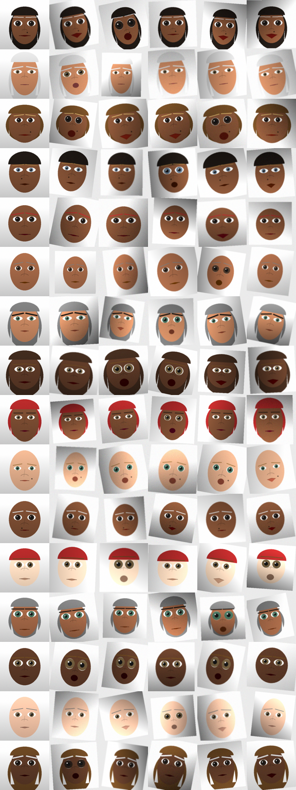

# face-simulator

Synthetic faces and a test harness for evaluating **face-authentication
pipelines**. Generate reproducible, privacy-safe synthetic "identities" with
controlled capture variations (pose, lighting, expression, noise), feed them
into the system you are testing, and get back standard biometric metrics
(FAR / FRR / EER / ROC AUC / accuracy).



*Each row is one synthetic identity; each column is a different capture
variation. Column 0 is a clean frontal "enrollment" shot.*

## Why synthetic faces for testing

Testing a face-auth system needs data that exercises two properties:

* **within-identity consistency** — the same person is accepted across pose,
  lighting and expression changes (controls the *false reject rate*);
* **between-identity distinctiveness** — different people are rejected
  (controls the *false accept rate*).

Synthetic faces give you this with advantages over scraping real photos:

* **Privacy-safe** — no real person's biometrics are collected or stored.
* **Reproducible** — a seed fully determines a dataset, so tests are stable
  in CI and bugs are reproducible.
* **Controllable** — you can dial pose/lighting/noise to find where the
  pipeline degrades, and regenerate at any resolution or scale.

## Scope / intended use

This is a **functional / regression / performance testing** tool for a face
authentication pipeline **you are authorized to test**. The faces are
deliberately schematic (illustrative, cartoon-like), which is exactly what you
want for exercising *detect → enroll → verify → score* logic.

It is **not** built to impersonate real individuals and **not** built to
defeat liveness or presentation-attack (anti-spoofing) defenses. If your goal
is anti-spoofing / presentation-attack-detection evaluation, that is a
different problem governed by standards such as ISO/IEC 30107 and should use
vetted PAD datasets and an authorized red-team process.

## Install

```bash
pip install -e .          # installs numpy + Pillow
# or: pip install -r requirements.txt
```

## Quick start

Generate a labeled dataset (16 identities × 6 variations) plus a contact-sheet
preview:

```bash
python examples/generate_dataset.py --out out --identities 16 --variations 6
```

This writes `out/images/*.png`, a `out/manifest.json` with ground-truth labels,
and `out/contact_sheet.png`.

Run the verification benchmark with the built-in reference backend:

```bash
python examples/run_benchmark.py --out out
```

```
pairs: 240 genuine / 240 impostor
EER:   15.00%  (threshold=0.9911)
AUC:   0.9281
@EER threshold -> FAR=15.00%  FRR=15.00%  acc=85.00%
```

> The built-in `EmbeddingBackend` is a trivial image-similarity baseline for
> demonstration only — **not** a real face recognizer. Replace it with your
> system to get meaningful numbers.

## Testing *your* system

Implement one method. If your system exposes a pairwise compare / verify call:

```python
from facesim import AuthBackend, load_manifest, make_pairs, run_verification

class MyBackend(AuthBackend):
    def verify(self, image_a, image_b) -> float:
        # Call your face-auth API; return a similarity score
        # (higher == more likely the same identity).
        return my_face_api.compare(image_a, image_b)

samples = load_manifest("out")
pairs   = make_pairs(samples, max_impostor_per_genuine=1, seed=0)
metrics = run_verification(MyBackend(), pairs, root="out")
print(metrics.summary())
print(metrics.far_frr_at(threshold=0.8))   # operating point of your choice
```

If your system is **embedding-based**, override `embed(image) -> np.ndarray`
instead and the default `verify` will cosine-compare the vectors.

For an **enroll/probe** protocol (one reference per identity, matched against
probe captures) use `enroll_probe_split(samples)` and compare each probe to the
enrollment references.

## How it works

| Module | Responsibility |
| --- | --- |
| `facesim/params.py`  | `FaceParams` identity description; `random_identity(seed)` samples a distinct, reproducible identity. |
| `facesim/render.py`  | `render(params, size, variation)` draws a face; `Variation` models pose / lighting / expression / noise / blur. |
| `facesim/dataset.py` | `generate_dataset(...)` writes images + manifest; `make_pairs` and `enroll_probe_split` build labeled evaluation sets. |
| `facesim/harness.py` | `AuthBackend` adapter, reference `EmbeddingBackend`, `run_verification`, and `compute_metrics` (FAR/FRR/EER/AUC). |

`Metrics` gives you `eer`, `eer_threshold`, `auc`, `far_frr_at(t)`,
`accuracy_at(t)` and the raw `scores` / `labels` arrays for your own plots.

## Limitations

* Faces are schematic, not photorealistic; absolute error rates on them will
  not match rates on real-world captures. Use them for **relative** comparisons
  (pipeline A vs B, before vs after a change, robustness to a variation sweep)
  and for functional/regression coverage.
* `Variation` pose is a cheap 2D affine proxy for 3D head pose, not a true
  reprojection.

## Tests

```bash
pip install pytest
pytest -q
```

## License

MIT (see `LICENSE`).
